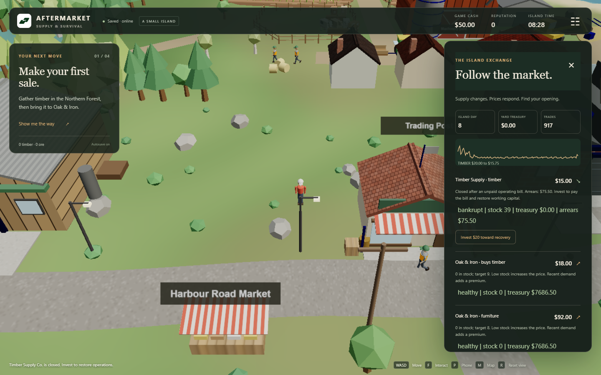
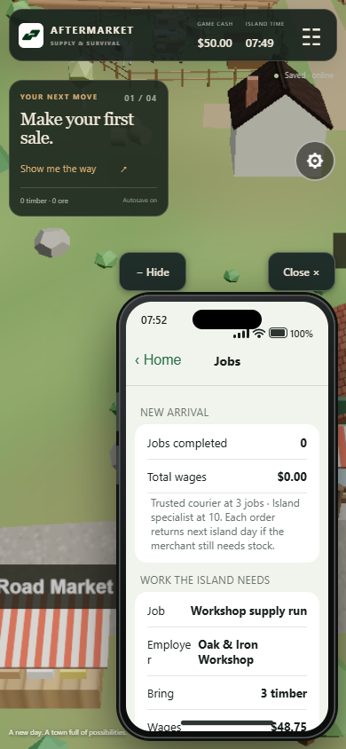
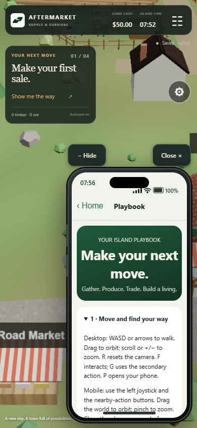

# AFTERMARKET: Supply & Survival


The economy is the gameplay: gather, craft and run a business among merchants that run out of cash, close, and reopen when a player invests. Items settle as real NEP-245 tokens on NEAR testnet through a managed in-game wallet, with no seed phrases, wallet popups or gas prompts in normal play.

**[Play now → aftmarket.xyz](https://aftmarket.xyz)** · Play as guest, one click, no signup.



*Actual hosted game, November 13. The exchange shows what merchants own, what they can afford and why their prices change. [Screenshot verification](docs/SCREENSHOT_EVIDENCE.json).*

## Verify the chain without running anything

- **Contract:** [aftermarket-game.testnet](https://testnet.nearblocks.io/address/aftermarket-game.testnet)
- **WASM SHA-256:** `6c18475191ba6237338f18acaa15426e3d84f6f2284ea6cf8205ef0c716bda3c`
- **Real receipts:** [deployment](https://testnet.nearblocks.io/txns/ANjnywCznt4y1ZnsPuShySypLXyvSNL2GPvfw7Reb17e), [hosted furniture mint](https://testnet.nearblocks.io/txns/J2NJm9TAymoEym8PYgryd5vxxxbym13bvY8UsMqpszSd), [merchant-funded delivery wages](https://testnet.nearblocks.io/txns/26b9YefLP7En7gHJZa7i58hye9V7521URwK7KXVMeBoZ).

[Deployment evidence](docs/TESTNET_EVIDENCE.json), [hosted core-loop evidence](docs/DEMO_CHECK_EVIDENCE.json) and [hosted job evidence](docs/LIVE_JOB_EVIDENCE.json) record the balances and transaction hashes. Explorer receipt logs contain multi-token events; its account page may not index NEP-245 inventory. Automated explorer requests returned HTTP 403, so a public RPC inspector is also provided, with no signing key required:

```sh
npm ci
npm run near:items -- 0aa0bedd6ff98b42a7a590cc6eccffa56a3eb030fa365cfa351ca90ad9b24a36
```

## Try it in 60 seconds

**Terminal first, for screeners without a browser or email.** From a fresh clone:

```sh
npm ci
BASE_URL=https://aftmarket.xyz npm run demo:check
```

The checker creates an isolated guest through the API, gathers three timber, crafts furniture, runs the seven-day preview and verifies a final on-chain item balance with a matching mint receipt. It prints the owner, item, explorer link and before/after prices, and exits non-zero on failure. This complete check takes several minutes, including the one-minute preview and asynchronous settlement. [PowerShell syntax and optional sale check](docs/OPERATIONS.md#browser-free-screener-check).

**In the browser, start the loop in about a minute:**

1. Open [aftmarket.xyz](https://aftmarket.xyz) and choose **Play as guest / demo account**. Open **Phone → Playbook** for controls and the first-sale guide.
2. **Phone → Map → Forest** marks your destination. Walk beside a tree and gather three timber. Use WASD/arrows or the touch joystick; F interacts, G performs the secondary action.
3. Walk to **Oak & Iron** (24, 7). **Phone → Business → Craft furniture** consumes three timber and $2 game credits; production takes eight island seconds.
4. **Phone → Marketplace → Sell** exchanges furniture for game credits, subject to merchant cash and capacity. Or accept a **Jobs** delivery first, bring its goods to the employer and collect the reserved wages.
5. Open the island exchange and start **Seven days. One minute.** Watch prices, stock, cash and trade counts change. Recovery investment pays a closed merchant's arrears and restores working capital.
6. In the exchange, scroll to **Inventory → Verify on-chain → Refresh verified inventory**. Ownership and receipts are optional details; recent actions may still be awaiting settlement. The headless checker retains its item; selling consumes it and produces a separate receipt.

<p align="center">
  
  
</p>

*Earn wages from merchant shortages, then build toward your own Trading Post. The phone also holds messages, tracking, in-game text calls, inventory and the Playbook. These are real hosted screenshots in a mobile-sized viewport, not physical-device performance evidence.*

## Track 9: Games With Real Economies

| Track example / game loop | Where to verify | Status |
|---|---|---|
| Economy drives play | [30-second / five-minute / session loop](docs/GAME_LOOP.md); finite stock, production, expenses and player decisions | Implemented; hosted gather/craft/sell and week checks |
| NPC wallets and inventories | [Settlement](server/near.cjs), [on-chain inspector](scripts/onchain-items.cjs), distinct merchant owner in [hosted evidence](docs/DEMO_CHECK_EVIDENCE.json) | Real contract-held identities and balances; custody explained below |
| Autonomous merchants | [Shared simulation](shared/core.js), [readable merchant rules](shared/merchant-rules.js); NPC procurement, production and trade | Rule-based economy; optional bounded Groq proposals |
| Prices from stock and demand; explain decisions | `shared/merchant-rules.js`; exchange quote reasons/tooltips | Implemented; hosted week changes all six recorded quotes |
| Bankruptcy and investment recovery | Merchant cash, bills, arrears and closure rules | Engine/browser verified; not a new hosted recovery receipt |
| Player-owned market | Trading Post stock, pricing, capital and upgrades; [licence evidence](docs/LIVE_GAME_EVIDENCE.json) | Real testnet bound licence; separate island per player |
| NEP-245 items in one contract | [Rust contract](contracts/economy/src/lib.rs), deployed hash and receipts above | Deployed and verified on testnet |
| Social **or email** sign-in, invisible chain | Supabase email links through Resend and managed in-game wallets; [live email proof](docs/EMAIL_VERIFICATION.json) | Hosted email send, provider delivery, actual link return, reload and guest verified; Google disabled |
| One week in about a minute; offline evolution | [Elapsed-time scheduler](server/simulation.cjs), same fixed-step rules at 49× | Hosted preview verified; idle islands catch up when loaded |

The [track prompt](https://github.com/nearai/near-hackathon-prompt-examples/blob/main/tracks/09-games.md) and [live organizer rules](https://nearhackathon.com/HACKATHON.md) are the source of this mapping. Testnet is eligible. The full [requirements checklist](HACKATHON_REQUIREMENTS.md) distinguishes implementation from verification.

## How NEAR is used

Each merchant has its own wallet identity and on-chain inventory (contract-held, server-managed), not a separately funded native NEAR account.

| System | On-chain | Off-chain / trust boundary |
|---|---|---|
| Items | NEP-245 timber, furniture, ore, gold and farm goods | Server validates actions; ordered checkpoints mint/burn net changes |
| Player wallet | Stable owner identity and confirmed token balances | Managed in-game wallet derived from the user ID and server-held key; custodial, not MPC |
| Merchants | Distinct per-island contract-held owner identities and token balances | Server-managed keys; autonomous rule-based merchants, not independently signing native accounts |
| Credits | `cash` mirrors integer game cents | Non-redeemable game credits; no NEAR/fiat backing |
| Business | Bound `trading-post:<world-id>` licence | Server validates acquisition, investments, prices and upgrades |
| Fees | Operator sponsors testnet gas and storage | No keys, wallet prompts or gas management for players |
| Persistence | Confirmed ownership and replay-protected world revisions | Supabase atomic progress/history/outbox; asynchronous settlement |

Groq dialogue and bounded merchant proposals use the owner's configured `openai/gpt-oss-20b` model. The owner reports it working; automated provider tests use mocks. AI cannot calculate authoritative balances, bypass trade validation or change the deterministic pricing rules. [Agent boundaries](docs/MERCHANT_AI.md).

## Baseline, hackathon work and AI disclosure

Available history starts with a [November 9 import](https://github.com/investorVOU/Aftermarket/tree/957283d) of the earlier Claude-generated v0.6 game. That import already contains backend/contract work; it is not an untouched pre-hackathon baseline. The island, characters, camera, phone and original local simulation are disclosed as baseline.

Persistent server economy, atomic saves/outbox, NEAR settlement, the screener checker, merchant jobs and guest recovery were developed during the hackathon. [Published November 13 checkpoint](https://github.com/investorVOU/Aftermarket/tree/ccf254e) · [import-to-checkpoint diff](https://github.com/investorVOU/Aftermarket/compare/957283d...ccf254e) · [history limitations](docs/BASELINE.md). Historical tags are not presented as the final release.

AI use: baseline generated with Claude; backend, NEAR work and subsequent improvements developed with Codex assistance. Libraries include Three.js, Supabase JS, Postgres.js, near-api-js, Rust near-sdk, esbuild, PGlite and jsdom. Project code is [MIT](LICENSE); third-party licences remain with their authors. No other-chain deployment, NEAR Intents integration or NEAR Auth/MPC login is claimed.

## Architecture and commands

```text
Three.js island + phone → authenticated server intents → deterministic economy
                                                       ↓
                              atomic Supabase save + transactional outbox
                                                       ↓
                                    sponsored NEAR testnet settlement
```

Local movement is predicted immediately and reconciled with authoritative state. Economy, inventory and ownership remain server-authoritative. [Architecture](docs/ARCHITECTURE.md), [merchant jobs](docs/JOBS.md), [operations and local setup](docs/OPERATIONS.md), [Resend email setup](docs/EMAIL_DELIVERY.md), [claim audit](docs/README_CLAIMS.md).

Island lighting follows the persisted clock through dawn, day, dusk and night,
with warm windows and lamps. The right-side **Camera** tab contains zoom, orbit,
tilt and reset controls. **Your next move** collapses to a compact objective and
remembers its state on this browser. [Layout and lighting checks](docs/NIGHT_SIDEBAR_VERIFICATION.json)
use local desktop/mobile Chrome; [clock-cycle verification](docs/CLOCK_CYCLE_VERIFICATION.json)
uses the actual development week preview.

[Feature brief for the narrated demo](docs/AFTERMARKET_FEATURES_FOR_VOICEOVER.md) includes gameplay facts, footage suggestions and the boundaries a voice-over should preserve.

```sh
npm ci
npm run build
npm run lint
npm test
npm run contract:build
npm run test:contract
```

### Known limitations

- Hosted email delivery was confirmed by Resend and the actual verification link returned to a persistent island. Physical inbox placement and a second physical device remain unverified. Guest entry is a separate demo convenience. Google is disabled; adding OAuth is optional.
- Each player has a separate persistent island. There is no shared multiplayer/P2P market; one backend instance is supported.
- New guest accounts have a rolling 24-hour creation quota. The Blueprint defaults to 200; existing Render services must update the older explicit value of 30. Email sign-in remains a separate path. [Guest capacity settings](docs/OPERATIONS.md).
- Custodial managed keys and a privileged settlement controller; no MPC, user key export or external-transfer indexer. Pending settlement can delay final ownership.
- Short accelerated Chrome samples do not establish physical-phone FPS or universal smoothness. Render cold starts and upstream service latency affect entry and confirmations. [Measured performance](docs/PERFORMANCE.md).
- Phone loans have local financial/API/browser verification; no hosted loan receipt is claimed. Groq live operation is owner-reported, not independently reverified here.
- A demo video and public X demo-post URL have not been provided. The public repository and hosted game alone do not complete the organizer's final submission process.
