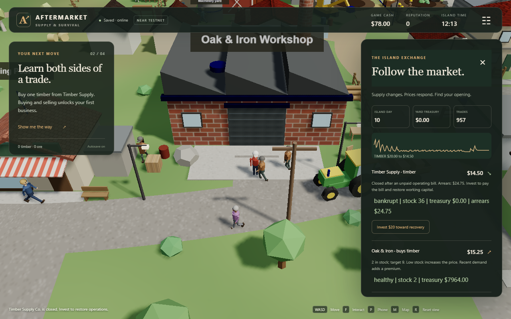

# AFTERMARKET: Supply & Survival

The economy is the gameplay: autonomous rule-based merchants buy inputs, produce goods, run out of cash, close, and reopen when a player invests. Items settle as real NEP-245 tokens on NEAR testnet through a managed in-game wallet; normal play needs no wallet setup, keys or gas prompts.

**[Play now](https://aftmarket.xyz)** — Play as guest, one click, no signup.

**Demo video:** `<DEMO_VIDEO_URL>` · **X demo post:** `<X_POST_URL>`



Hosted guest entry, gathering, crafting, the seven-day preview and a final furniture mint passed on November 13. [Hosted API and chain evidence](docs/DEMO_CHECK_EVIDENCE.json) records the real transaction and changed prices. Selling and the Trading Post licence have separate earlier testnet evidence. Hosted evidence and local client measurements are distinguished in the [claim audit](docs/README_CLAIMS.md).

## Verify the chain without running anything

- **Contract:** [aftermarket-game.testnet](https://testnet.nearblocks.io/address/aftermarket-game.testnet)
- **WASM SHA-256:** `6c18475191ba6237338f18acaa15426e3d84f6f2284ea6cf8205ef0c716bda3c`
- **Receipts:** [contract deployment](https://testnet.nearblocks.io/txns/ANjnywCznt4y1ZnsPuShySypLXyvSNL2GPvfw7Reb17e), [verified timber mint](https://testnet.nearblocks.io/txns/C7Ppi3bMkt4L5f5CSFqvgkcWYmukqGNR6wXnuaZXV35W).

The IDs and hash match [testnet evidence](docs/TESTNET_EVIDENCE.json). [Game-loop evidence](docs/LIVE_GAME_EVIDENCE.json) separately records actual gather/craft/sell receipts and a Trading Post licence. Explorer receipt logs show ownership even when the explorer does not index multi-token inventory on its account page.

The explorer returned HTTP 403 to automated link checks in this environment. Its canonical links match the recorded hashes; the public RPC inspector below provides a verification path without its web interface. [Link-check results](docs/README_LINK_CHECK.json).

Optional read-only check of the recorded player, without a signing key:

```sh
npm ci
npm run near:items -- 047db926e52e94b6f4ecf8cb6a2b00d7b12eb21bb728b3fc935b0d664f2fed20
```

## Try it in 60 seconds

**Terminal-only verification comes first.** A fresh clone can check the hosted API without email, CAPTCHA, a browser or private operator credentials:

```sh
npm ci
BASE_URL=https://aftmarket.xyz npm run demo:check
```

This creates an isolated guest, gathers three timber, crafts furniture, runs the actual seven-day preview, and checks final ownership plus a matching mint receipt. It prints before/after merchant prices, the item, owner and explorer transaction link; any failed check exits non-zero. Allow several minutes for the complete check, including the one-minute preview and settlement. [PowerShell syntax and operations](docs/OPERATIONS.md#browser-free-screener-check).

For browser play, start the core loop in about a minute; the week preview takes another minute:

1. Open [aftmarket.xyz](https://aftmarket.xyz) and choose **Play as guest / demo account**.
2. Open the bottom-right **Phone → Map → Forest**. Walk to a tree and gather three timber. Use WASD/arrows or the touch joystick; F interacts, G performs the secondary action.
3. Walk to **Oak & Iron** (24, 7). **Phone → Business → Craft furniture** consumes three timber and $2 game credits; wait eight island seconds.
4. **Phone → Marketplace → Sell** sells furniture for game credits. The server validates ownership and merchant funds.
5. Open the island exchange and choose **Seven days. One minute.** Watch prices, stock, cash and trade counts change. If a merchant closes, invest until its arrears are paid and working capital is restored.
6. Open **Inventory → Verify on-chain**, then **Refresh verified inventory**. Receipts and identities are inside this collapsed section; normal play keeps the chain out of the way. Hosted assets matched this friendly inventory build on November 13; the recorded headless chain check used the preceding deployment.

NPC conversations live in the phone as message threads. Known contacts also offer tracking and in-game text calls based on current activity; these are not real telephone or voice calls.

## Track 9 checklist

| Game requirement | Implementation and evidence |
|---|---|
| The economy drives play | Finite cash/stock, production, changing quotes and recovery investment; local checks and earlier testnet loop |
| Autonomous rule-based merchants | [Simulation](shared/core.js), [readable merchant rules](shared/merchant-rules.js); no LLM balance calculations |
| Merchant decisions are explainable | Quote reasons and tooltips; stock, treasury, closure and arrears |
| Player-owned market | Trading Post progression and bound licence; [recorded testnet evidence](docs/LIVE_GAME_EVIDENCE.json) |
| Offline evolution and week preview | [Elapsed-time scheduler](server/simulation.cjs); same fixed-step economy at normal and accelerated speed |
| NEP-245 items | [Single Rust contract](contracts/economy/src/lib.rs), deployed hash and public receipts above |
| Frictionless entry | Hosted API guest/session verified; managed in-game wallet. Personal email/Google callbacks remain unverified |

## How NEAR is used

| System | On-chain | Off-chain / trust boundary |
|---|---|---|
| Items | NEP-245 balances for timber, furniture, ore, gold and farm goods | Server validates gathering, production and trades; ordered checkpoints mint/burn net changes |
| Player wallet | A stable contract-held owner identity and confirmed balances | Managed in-game wallet derived from the user ID and a server-held managed key; custodial, not MPC |
| Merchants | Separate contract-held ledger identities and balances derived from the managed key | Autonomous rule-based merchants, not AI agents and not individually funded native NEAR accounts |
| Credits | The `cash` token mirrors integer game cents | Non-redeemable game credits, without NEAR or fiat backing |
| Business | Bound `trading-post:<world-id>` licence | Server validates ownership, investment, prices and upgrades |
| Fees | Operator pays testnet gas/storage | Players do not manage keys, wallet prompts or gas during normal play |
| Persistence | Confirmed ownership and replay-protected revisions | Supabase stores progress, economic history and the transactional outbox; settlement is asynchronous |

## Baseline, hackathon work and AI disclosure

Available history starts with a [November 9 import](https://github.com/investorVOU/Aftermarket/tree/957283d) of the earlier v0.6 game. That import already includes backend/contract work, so it is not an untouched pre-hackathon baseline. The island, characters, camera, phone and original local simulation are disclosed as baseline.

[Published review checkpoint](https://github.com/investorVOU/Aftermarket/tree/58d2cca) · [import-to-checkpoint diff](https://github.com/investorVOU/Aftermarket/compare/957283d...58d2cca) · [baseline and branch details](docs/BASELINE.md). Existing tags are historical checkpoints; none is presented as an unpublished final release.

AI disclosure: the baseline was generated with Claude; backend, NEAR integration and subsequent improvements were developed with Codex assistance. Libraries include Three.js, Supabase JS, Postgres.js, near-api-js, Rust near-sdk, esbuild, PGlite and jsdom. Project code is [MIT](LICENSE); third-party licences remain with their authors. No other-chain deployment, NEAR Intents integration or NEAR Auth/MPC login is claimed.

## Architecture and commands

```text
Three.js game / phone → authenticated server intents → economic simulation
                                      ↓ atomic PostgreSQL save + outbox
                                 sponsored NEAR testnet settlement
```

The [shared economy](shared/core.js) owns deterministic game rules. The server owns transaction validation, persistence and offline catch-up. Client movement predicts presentation only; it does not authorize money, inventory or ownership.

```sh
npm ci
npm run build
npm run lint
npm test
npm run contract:build
npm run test:contract
```

Credentials-free local play, Supabase configuration, Render deployment, managed-key custody and recovery commands are in [OPERATIONS.md](docs/OPERATIONS.md). [Claim-by-claim verification](docs/README_CLAIMS.md) distinguishes hosted results, testnet evidence and local checks. [Movement measurements](docs/MOVEMENT_PROFILE.json) distinguish the deployed client from the unpublished candidate.

### Known limitations

- Separate island per player and one supported backend instance; no shared multiplayer/P2P market.
- Managed custody and privileged settlement controller; no MPC, key export or external-transfer indexing.
- Settlement is asynchronous; failed or backlogged checkpoints can delay final ownership. The recorded hosted headless check confirms one real mint, not an uptime guarantee.
- Google is disabled in the observed hosted configuration; personal email delivery, OAuth callbacks and cross-device login are unverified.
- Desktop/mobile viewport checks do not establish physical-device FPS. Render cold starts and shared public RPCs affect response and confirmation time.
- Hosted assets matched the reviewed build on November 13. The recorded November 12 FPS comparison used the earlier deployment; physical-device performance remains unverified.

The server supports a private QuickNode NEAR testnet fallback for reads and settlement. [Real fallback verification](docs/QUICKNODE_VERIFICATION.json) and [verification mint receipt](docs/QUICKNODE_SETTLEMENT_EVIDENCE.json) record a deliberately unavailable primary provider. Operators configure it privately through [OPERATIONS.md](docs/OPERATIONS.md#quicknode-fallback).
